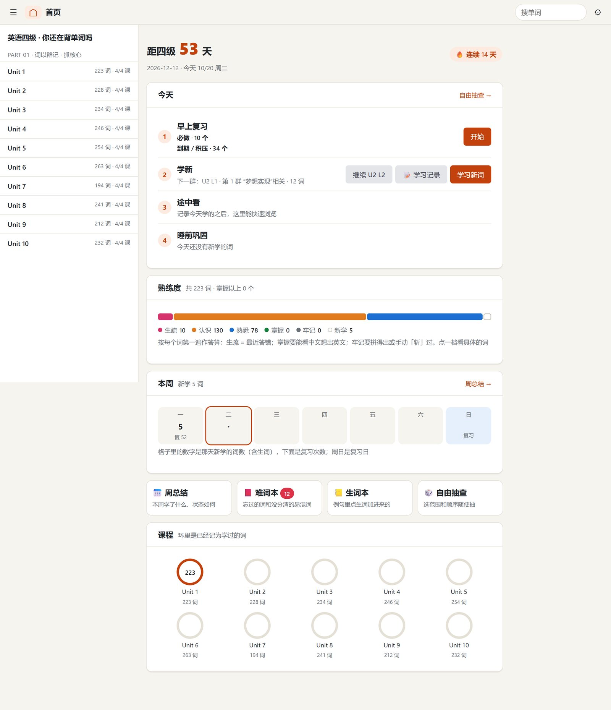
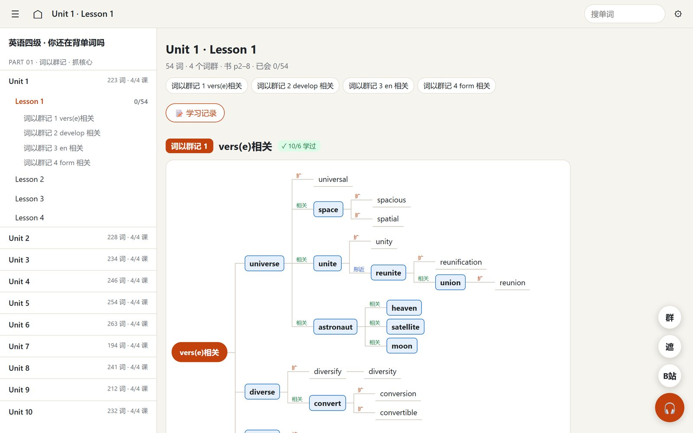
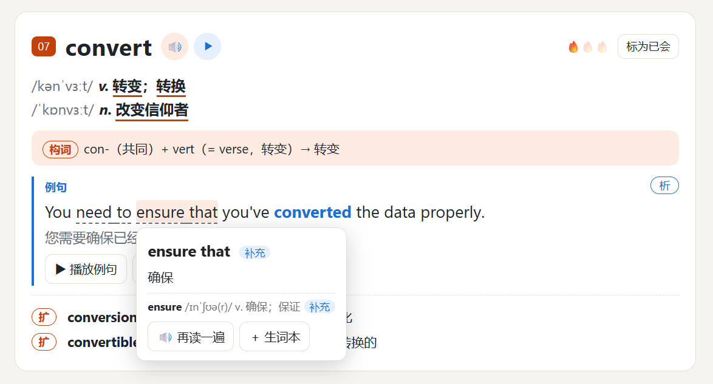
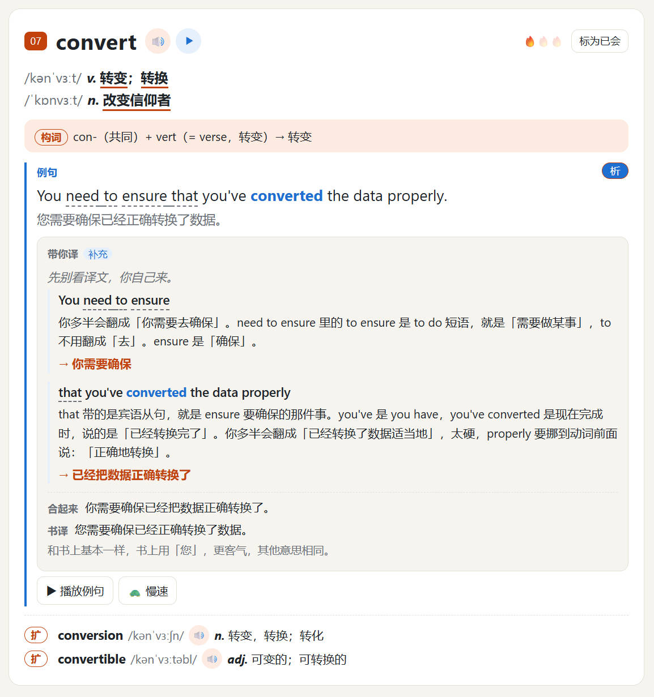
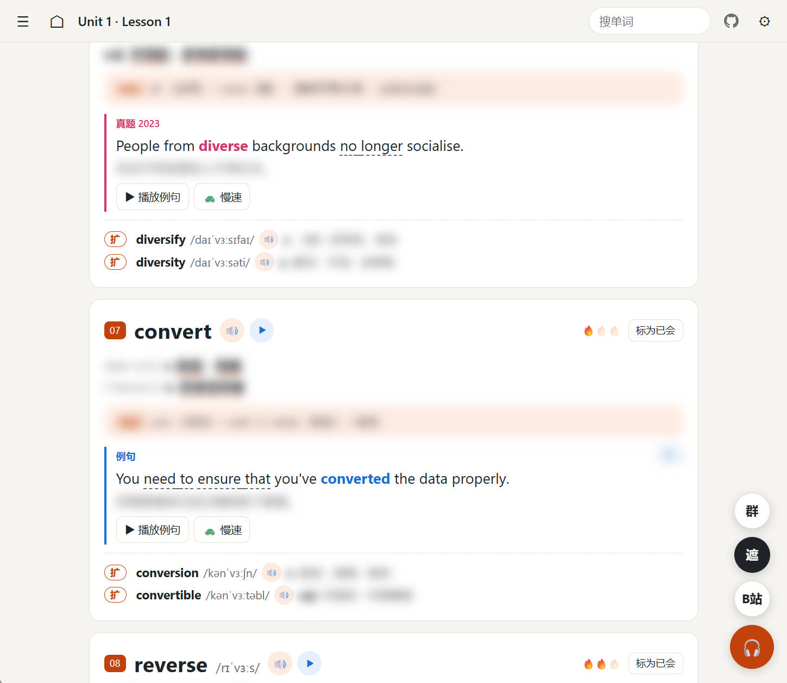
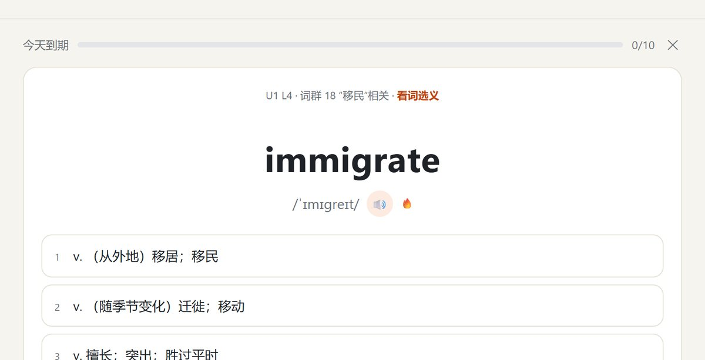
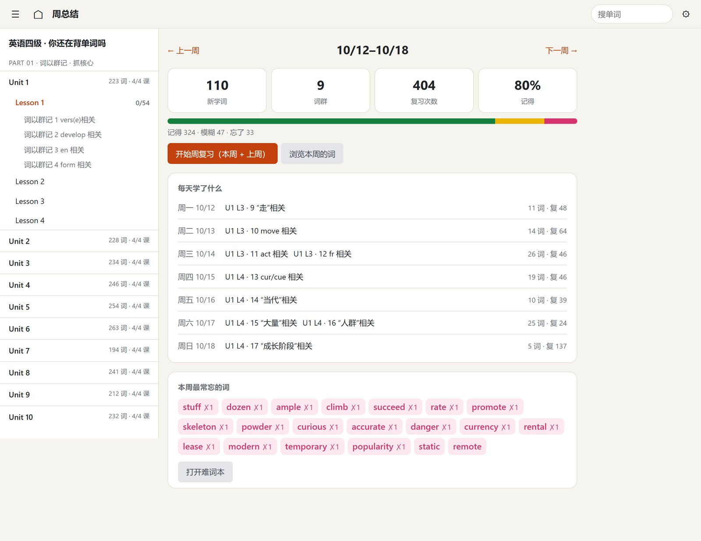
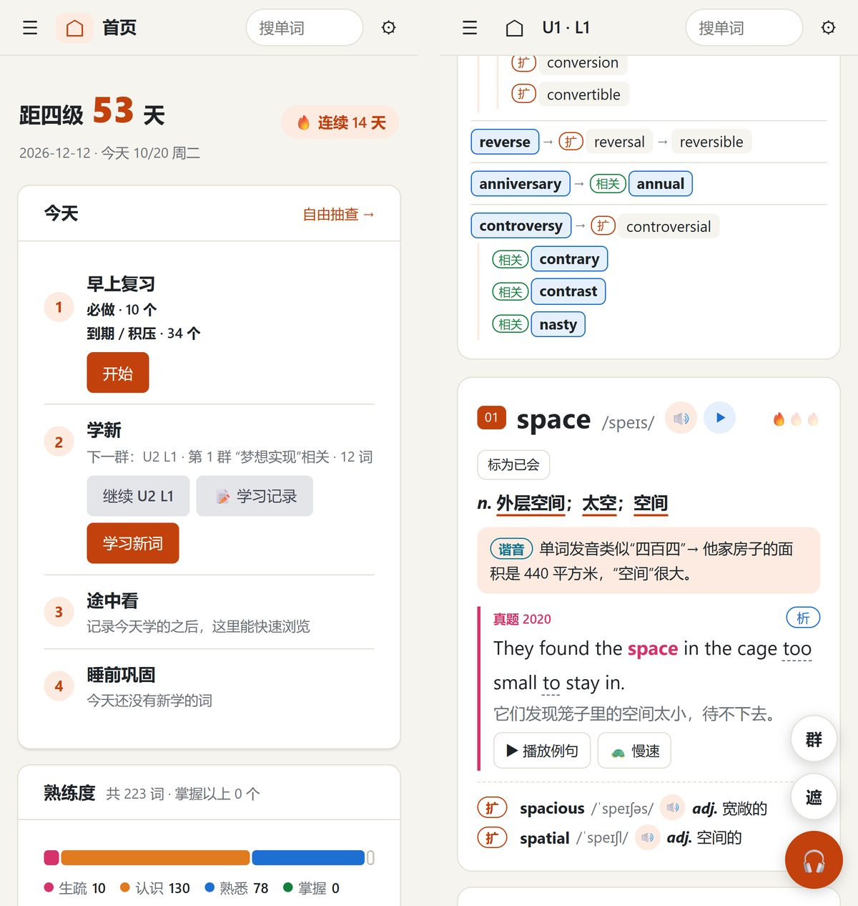

# 四级词汇网页课件 · 词以群记在线背单词（CET-4）

[](https://cet4.owenwoow.com/)


将刘晓艳《英语四级 · 你还在背单词吗》做成了**可交互的英语四级单词网页课件**，并用 AI 补上纸质书没有的东西：思维导图、单词和例句发音、例句朗读高亮、点词查义、背诵遮挡、磨耳朵。首页是一个背词门户，按**滚动复习**排好每天要复习多少、要学哪几个词群，带巩固练习、难词本、生词本和周总结。

**👉 打开就能用：<https://cet4.owenwoow.com/>**（电脑、手机都行，不用注册）



## 功能一览

### 词群思维导图

每个「词以群记」词群都有一张导图，把词根相同、意思相关、拼写形近的词串在一起，课文页和词群速览里都能看。




### 例句点词查义、朗读高亮

- 单词、例句（含四级真题例句）都有发音，例句播放时逐词高亮，可慢速
- 点例句里任意一个词就能看到释义，生词一键加进生词本
- 例句标出常用词组，带「对话带练」式的翻译和语法讲解
- 书上用谐音、联想记的词，能拆出公认词根的补了一条词根词缀记法

书外的内容都由 AI 生成，页面上标着「补充」，和书上原文分开。






### 背诵遮挡、磨耳朵

右下角「遮」打开背诵模式，中文释义和翻译先挡住，点一下看答案；「🎧」从头到尾连着播整课，通勤路上磨耳朵。



### 滚动复习与巩固

- 学完次日复习，之后从每次复习的日子往后数：隔 3 天、隔 7 天，再按熟练度拉开（7～30 天）；哪天没做不会挤到一起，考前自动把复习收拢到考试前一周
- 题型随熟练度升级：看词选义 → 听音选义 → 例句挖空 / 看中文选英文 → 拼写
- 复习太多时自动少学或停学新词，积压会估算几天能清完
- 难词本收集忘过的词和没分清的易混词，周总结看一周学了什么、哪些词最常忘

<p align="center"></p>



### 手机上也好用

<p align="center"></p>

### 进度备份与多设备同步

学习记录默认存在浏览器里，可以导出 / 导入备份文件；也可以填一个自己的 GitHub Token，把进度同步到自己账号下的私密 Gist，电脑和手机之间互相接上（见 [云同步使用说明](docs/云同步使用说明.md)）。

## 本地运行

纯静态站点，没有后端。需要用本地服务器打开（直接双击 HTML 时 `fetch` 会被浏览器拦下）：

```bash
python -m http.server 8765 --directory site
```

然后打开 <http://localhost:8765>。音频放在单独的仓库 [cet4-vocab-audio](https://github.com/Owenwoow/cet4-vocab-audio)，本地要听音频的话克隆到 `audio-store/` 再起一个 8766 端口的服务。

测试：

```bash
python pipeline/validate.py
```

```bash
node --test "tests/*.test.js"
```

## 项目结构

| 目录 | 内容 |
|---|---|
| `site/` | 静态站点本体：`app.js` 课文与设置，`study.js` 首页 / 巩固 / 周总结，`srs.js` 复习规则，`sync.js` 存储与云同步，`sent.js` 例句与词组定位 |
| `site/data/lessons/` | 每课一个 JSON，是所有课程内容的唯一数据源 |
| `site/data/gloss/` `notes/` `roots/` | AI 补充的逐词释义、词组与语法讲解、词根记忆法 |
| `pipeline/` | 数据流水线：书页抽图 → AI 抽取成 JSON → 校验 → 生成释义和讲解 → 生成音频（edge-tts） |
| `tests/` | 复习规则、词组定位、备份合并等纯函数的单元测试 |
| `.github/workflows/` | 推送 `main` 后自动校验数据、跑测试、部署到 GitHub Pages；音频在 Actions 里云端生成 |

课程数据是用 Claude Code 的子代理从书页扫描图抽取的，每课都经过 `pipeline/validate.py` 校验（词条序号、词群编号、例句词组位置等）才会上线。

## 声明

- 课文内容取自刘晓艳《英语四级 · 你还在背单词吗》，与书上逐字一致，版权归原作者和出版社所有；本项目是个人学习用的非官方课件，不提供原书扫描页。如有侵权请提 Issue，会及时处理
- 例句逐词释义、词组讲解、词根记忆法、发音均为 AI 生成，可能有错，页面上都标了「补充」
